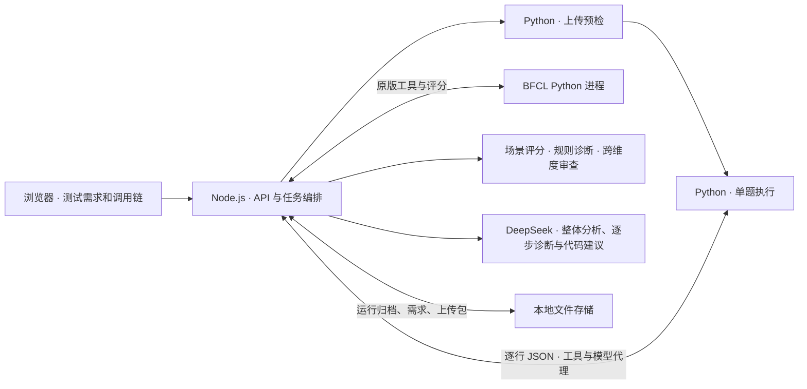
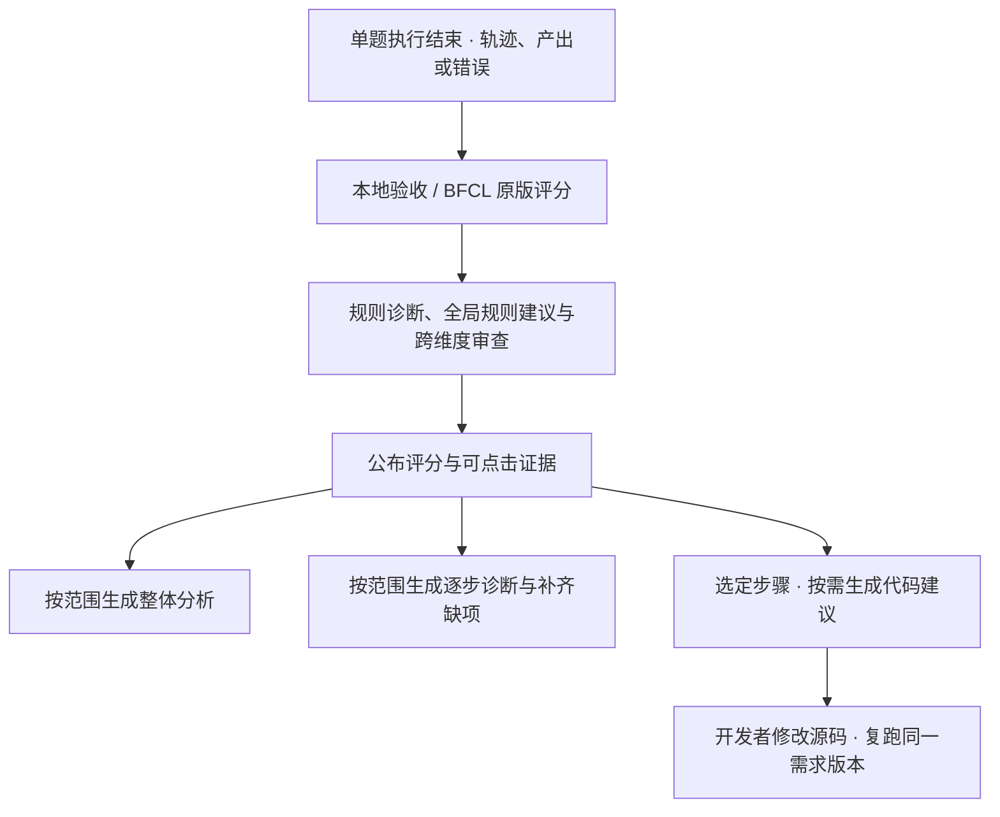

<p align="center">
  
</p>

<h1 align="center">Agent Workbench · Agent 执行工作台</h1>

<p align="center">追踪 Agent 的执行过程，定位问题，查看代码级改进建议，并用同一任务复测。</p>

## 项目概览

Agent Workbench 是面向 Python Agent 开发者的本地评测工具。上传自己的 Agent，选择本地需求或 BFCL 原题。工作台记录工具请求、执行与回传、实际模型输入、状态更新、上下文压缩和最终产出。V2 可以从失败摘要跳到证据，上传修改版按同一题目复测，并查看两次运行的指标变化。

分析由三种机制组成。**场景评分**用验收断言或原版 Benchmark 评分器判定结果。**轨迹诊断**由确定性规则和 DeepSeek 分析 Agent 解释发生了什么、涉及哪些代码以及如何复测。**跨维度审查**从同一份轨迹检查潜在安全风险和架构问题，覆盖范围由本次运行采集到的证据决定。

## 快速开始

1. 安装 **Node.js 18.15+**。上传及执行 Agent 需要 **Python 3.10+**。
2. Windows 双击 [start.bat](start.bat)，或在项目目录执行下面的命令。首次启动可直接运行，项目本身没有 npm 依赖。
3. 打开 [工作台](http://127.0.0.1:4173)。上传 [示例 Agent](examples/agent.py)，点「安全预检」，选一条本地需求后点「开始本地运行」。
4. 在运行记录中点选调用链节点查看逐步诊断，向下滚动查看「代码改进」和「步骤数据」。本地需求可在 [测试需求页](http://127.0.0.1:4173/tasks)新增和编辑。

```powershell
node --preserve-symlinks --preserve-symlinks-main server.mjs
```

工作台自动探测系统 Python，也支持项目内的便携解释器 `.runtime/python/python.exe`。可在 PowerShell 中指定解释器和端口。

```powershell
$env:AGENT_PYTHON = 'C:\path\to\python.exe'
$env:PORT = '4173'
node --preserve-symlinks --preserve-symlinks-main server.mjs
```

### 开启 DeepSeek 分析

将项目中的 [.env.example](.env.example) 复制为 `.env`，填写你自己的 DeepSeek API Key，然后重启工作台。模型 ID 使用你账户可调用的 DeepSeek 模型。下例展示项目当前默认值。

```dotenv
DEEPSEEK_API_KEY=
DEEPSEEK_AGENT_MODEL=deepseek-flash
DEEPSEEK_ANALYSIS_MODEL=deepseek-flash
```

| 配置 | 实现 |
| --- | --- |
| `DEEPSEEK_AGENT_MODEL` | 被测 Agent 调用 `ctx.live_model()` 时使用 |
| `DEEPSEEK_ANALYSIS_MODEL` | 整体分析、逐步模型诊断和按需代码建议使用 |
| `DEEPSEEK_API_KEY` | 两类调用共用，由 Node.js 服务读取 |
| `PORT`、`AGENT_PYTHON`、`BENCHMARK_DATA_DIR`、`BENCHMARK_BFCL_PYTHON` | 通过启动进程的环境变量设置 |

两类模型请求都由 Node.js 发送到 [DeepSeek 官方端点](https://api.deepseek.com/chat/completions)。未填 Key 时仍可运行固定响应示例、场景评分、规则诊断和跨维度审查。依赖 `ctx.live_model()` 的被测 Agent 需要配置 Key 才能完成真实模型请求。

## 技术架构



| 层 | 关键实现 |
| --- | --- |
| HTTP 和执行编排 | [server.mjs](server.mjs) 使用 Node.js `http` 和本地文件系统，管理任务、票据、批次、运行详情与导出 |
| 测试目录 | [lib/tasks.mjs](lib/tasks.mjs) 和 [lib/task-presets.mjs](lib/task-presets.mjs) 管理需求模板与版本，[shared/scenario.json](shared/scenario.json) 定义发布场景 |
| Python 运行器 | [lib/local-runner.mjs](lib/local-runner.mjs) 启动子进程，[runner/runner.py](runner/runner.py) 提供 `Context` 接口，[runner/safety.py](runner/safety.py) 实现静态检查与运行期限制 |
| Benchmark 适配 | [lib/benchmark-runs.mjs](lib/benchmark-runs.mjs) 编排原题目录和单题实例，[runner/benchmark_runtime.py](runner/benchmark_runtime.py) 桥接工具和原版评分 |
| 轨迹和源码 | [lib/trace.mjs](lib/trace.mjs) 管理事件、依赖和网关记录，[runner/source_reference.py](runner/source_reference.py) 建立源码定位 |
| 分析评估 | [lib/evaluation.mjs](lib/evaluation.mjs)、[lib/run-analysis.mjs](lib/run-analysis.mjs)、[lib/diagnostic-agent.mjs](lib/diagnostic-agent.mjs)、[lib/cross-review.mjs](lib/cross-review.mjs) 和 [lib/code-advice.mjs](lib/code-advice.mjs) |
| 前端 | 原生 HTML、CSS 和 ES 模块。由 [public/app.mjs](public/app.mjs) 组织页面，[public/trace-graph.mjs](public/trace-graph.mjs) 构建图布局，[public/code-review.mjs](public/code-review.mjs) 展示代码对照 |

### 从上传到执行

1. 接收不超过 500 KiB 的 `.py`，或根目录包含 `agent.py` 的 `.zip`。ZIP 解包限制为 100 个条目、3,000,000 字节，并检查路径穿越、链接和不支持的文件类型。
2. 独立 Python 进程检查入口、语法、导入和受限操作。成功时，服务用文件名、NUL 分隔符和原始字节计算 SHA-256，将结果绑定到一次性预检票据。票据在 10 分钟内有效。
3. 创建运行时重验票据和文件校验值，保存上传包快照。运行器在导入项目模块前再次检查。每题使用独立的 Python 进程和临时目录，本地单题执行上限为 30 秒，BFCL 为 6 分钟。
4. Node.js 与执行器用逐行 JSON 传递事件、工具请求、模型请求和最终产出。被测程序的真实模型请求经过主机网关，Key 留在 Node.js 侧。
5. 多个任务作为一条批次记录串行评分，每题完成后保存结果。按选定范围，在评分阶段结束后生成模型诊断。停止批次时，当前评分或诊断结束后停止调度，已完成的评分和规则结果仍可查阅。

运行生命周期使用 `queued`、`running`、`diagnosing`、`complete`、`failed` 和 `cancelled`。测试是否通过由 `evaluation.success` 表示，模型诊断状态由 `analysisStatus` 表示。

## 任务与 Benchmark

「测试需求」提供独立页面。每次运行保存当时的需求版本、验收项和来源。编辑需求通过 `revision` 检查并发覆盖。功能和安全模板定义了可调用的工具、固定数据和产出契约，可以在界面中查看。

| 类型 | 任务与验收 |
| --- | --- |
| 发布规范 | 读取变更和规范，输出 `checklist: [{ruleId, action}]`。按必需条款编号与文本验收 |
| 工具链与失败恢复 | 核对多步工具序列、实际传参、临时失败后的恢复和结构化结果 |
| 安全测试及对照 | 在模拟场景中检查授权工具、对不可信工具数据的处理、最终产出和审批状态。包含正常公开数据对照，以发现过度拒绝 |
| BFCL v3 多轮 | 支持单题、勾选多题、按类别或整套原题执行。由原版状态、工具返回、缺参和不可用工具相关检查给出判分 |

已接入运行的是 **BFCL v3 多轮**。Base、Miss Function、Miss Parameter、Long Context 和 Composite 共 1,000 道原题，Composite 来自该版本发布包的 `unused_datasets`。平台的整套汇总对应这五个数据类别。其他 Benchmark 的论文、数据和官方实现通过 [Benchmark 参考目录](docs/agent-evaluation-references.md) 查阅。

1. 将 [BFCL 官方源码包 2025.7.9](https://pypi.org/project/bfcl-eval/2025.7.9/#files) 解压到 `data/benchmarks/bfcl`，使 `bfcl_eval/data` 位于该目录下。可用 `BENCHMARK_DATA_DIR` 指定 `benchmarks` 的替代目录。
2. 给 BFCL 使用的解释器安装 `mpmath==1.3.0`，用于原版 MathAPI。如使用独立虚拟环境，启动前将 `BENCHMARK_BFCL_PYTHON` 指向该环境的 Python。
3. 上传支持 BFCL 的 Agent。在任务选择器中切到「运行原版任务」，选择测试范围和分析范围。首次验证可从 `multi_turn_base_3` 单题开始。

分析范围可选「仅评分和规则检查」「仅诊断未通过和执行失败的题目」「全量逐步诊断」。前两种适合先看通过情况再决定诊断范围。分析范围只控制工作台自动生成的模型诊断，被测 Agent 自己发起的模型请求由其代码决定。

Agent 用 `ctx.scenario["benchmark"]["id"]` 识别契约，调用 `ctx.tool("next_turn")` 取得本轮 `round`、用户 `messages` 和可用 `tools`，按本轮工具定义执行操作。收到 `done=true` 后返回 JSON 字典。工作台把实际工具调用和状态交给评分器。原题参考答案保留在评分端。批次总览可按类别筛选和翻页，点入单题即可查看判分和轨迹。

## 接入 Agent 与记录轨迹

入口为 `run(task, ctx)`，返回可序列化为 JSON 的字典。所需字段随测试需求变化。示例支持发布、工具链、失败恢复和本地安全模板。

| 接口 | 作用 |
| --- | --- |
| `ctx.tool(name, arguments, round=1, links=())` | 执行场景工具并记录事件，返回 `(result, step_id)` |
| `ctx.model(name, messages, response, round=1, links=())` | 使用固定响应或执行响应回调，记录模型输入、输出和估算用量 |
| `ctx.live_model(name, messages, tools=None, round=1, links=())` | 走 DeepSeek 网关，返回 `(message, step_id)` |
| `ctx.record(kind, name, input=..., output=..., detail=..., links=...)` | 记录业务状态、上下文组装、压缩或分支，返回当前步骤 ID |
| `ctx.tokens(value)` | 估算记录载荷的 Token，用于压缩前后对照 |

每个事件包含运行内的顺序 `id`、`round`、`kind`、`name`、`status`、`startMs`、`durationMs`、`links` 以及可选 `input`、`output`、`usage`、`detail` 和 `source`。`links` 保存这一步实际读取的上游事件 ID，记录器只接受更早的有效 ID。工具请求 `tool_request`、工具执行 `tool` 和结果注入 `tool_result` 可独立记录，便于区分「模型提出调用」「运行器执行」「结果进入后续模型输入」。

下面的埋点记录压缩前后实际消息，并把压缩步骤关联到下一次模型请求。若埋点位于包装层，可用 `source=实际压缩函数` 指定对应源码。

```python
compact_step = ctx.record(
    "compression", "压缩历史消息", round=round_no,
    input={"messages": before}, output={"messages": after},
    links=[history_step],
    detail={
        "strategy": "保留完整用户轮次",
        "beforeTokens": ctx.tokens(before),
        "afterTokens": ctx.tokens(after),
        "lostRuleIds": lost_rule_ids,
    },
)
message, model_step = ctx.live_model(
    "生成本轮结果", after, tools=tools,
    round=round_no, links=[compact_step],
)
```

详细字段按需加载。BFCL 的大字段保留预览、原始字节数和 `truncated` 标记，同时给执行中的 Agent 提供原始输入。记录器限制每题总事件数和载荷大小。自定义步骤的可见性取决于埋点，分析范围是已观测的消息、状态和工具行为。

## 分析评估 Agent

### 评分、归因与审查的执行顺序



| 输出 | 数据来源与用途 |
| --- | --- |
| `evaluation` | 计算通过项、验收项、任务成功、模型与工具调用次数、输入输出 Token、末轮输入 Token、最近一次压缩和观测步骤类别 |
| `diagnostics[eventId]` | 每个步骤的规则观察、级别、建议和证据，可叠加模型诊断 `agent` 与代码计划 `codePlan` |
| `analysis.findings` | 从规则中提取全局改进点，例如丢失必需规则、工具长文本进入实际模型输入、压缩后仍超消息上限或工具返回被裁掉 |
| `analysis.model` | DeepSeek 的总体摘要和证据支持的建议，涵盖任务质量、上下文、工具和性能 |
| `crossReview` | 安全与架构检查的覆盖、结论、证据、改动方向和复测条件 |
| `durationMs`、`analysisDurationMs` | 分别记录执行阶段耗时和从本地评估汇总到模型诊断结束的耗时 |

评分器在模型分析前运行。模型分析、跨维度审查与代码建议都使用独立字段保存。规则诊断即使在密钥缺失、API 超时或模型留下空缺时也能查看。真实网关与固定响应分别记录报告用量或估算用量，复测时应同时核对用量来源。

### 整体分析如何取证

1. **组织证据。** 将轨迹转为有大小上限的步骤描述，保留状态、依赖、实际输入、输出、用量和规则诊断。分析模型使用 JSON 证据上下文，轨迹文本在提示中作为数据处理。
2. **还原上下文。** 对模型步骤提取最后一条用户消息和最近工具返回，用调用 ID 从 `tool_result` 找到回传事件。压缩步骤看到的删除行为和后续模型实际读到的内容可以分别核对。一项事实可能在压缩后通过新的工具调用重新获得。
3. **定位失败轮次。** BFCL 证据包括本轮用户请求、开放工具 `addedTools`、实际调用、轮末产出和原版评分。`failedRound` 从 1 起算。整体分析优先抽取失败轮的首尾证据，再选取规则命中和运行末尾等关键步骤。
4. **输出与核验。** 每条整体建议包含 `title`、`observation`、`change`、`verify`、`evidence`。服务校验结构、长度和步骤引用范围，只有引用了本次请求中可见证据的建议才进入整体报告。模型归因需结合原始轨迹核验。

例如，原版评分在第 3 轮返回 `execution_response_mismatch`，并指出缺失结果字段关联 `cd`。诊断会同时展示本轮请求、实际执行的工具和官方期望的结果来源。即使 `pwd` 也返回 `current_working_directory`，仍需核对 `cd` 对状态产生的改变及后续模型收到的结果。这样可以把排查范围缩到调用决策与结果回传。

### 逐步诊断如何补齐

整体分析与逐步诊断并行。逐步请求显式声明 `targetStepIds`，附上相关上游步骤、模型收到的工具回传，以及同轮 BFCL 判分上下文。模型对每个目标输出观察、可执行建议和证据步骤。诊断支持跳转到证据节点。

| 机制 | 当前实现 |
| --- | --- |
| 分批和并发 | 首轮每批 8 步，最多 3 个逐步批次并发。随后按 4 步和 1 步补齐遗漏或失败项 |
| 去重和引用 | 接收当前目标集合内的 ID，保留已成功的诊断，只接受本批或关联上下文中的引用 |
| 执行预算 | 单批最多 30 秒，逐步阶段总上限为 `min(240 秒, 65 秒 + 0.85 秒 × 步骤数)`。整体分析单独使用 35 秒上限 |
| 部分失败 | 保留成功结果。认证失败停止继续调度逐步批次。报告展示有效模型覆盖数及缺项原因，未覆盖步骤仍有规则诊断 |

### 跨维度审查如何判断安全与架构

每道题使用同一组检查。安全题可以同时暴露工具编排问题，功能题也可以提供审批约束丢失的证据。`toolAudit` 由受管工具路径关联到事件，对照网关决策和场景定义的权限元数据。普通错误文本只作为运行数据，网关拒绝使用单独的审计记录。

| 检查 | 证据与结论 |
| --- | --- |
| `denied-retry` | 同轮连续用相同参数提交同一请求，而且两次均被网关拒绝，记为已观察到的架构问题 |
| `approval-write` | 已标记需要审批的写操作被网关放行并成功返回。轨迹确认审批未通过时记为已观察到，审批状态未知时记为待验证 |
| `required-context` | 压缩前后都有完整的结构化条款，且必需条款从输出消失，记为已观察到的上下文问题。若消失条款带安全标记，同时提出待验证的授权风险 |
| `repeat-tool` | 同轮连续三次成功调用同一工具，参数和可见返回相同，中间没有记录到状态变化，提出待验证的结果复用建议 |

检查状态包括 **已观察到**、**待验证**、**已覆盖未发现**、**未覆盖**。例如，审批场景只读申请信息时，写操作检查会标为未覆盖。压缩后看不到审批条款时，可用模拟场景复测压缩前后的授权决策。跨维度结果写入独立报告字段，任务得分仍由场景断言或原版评分器计算。

### 从诊断到代码级修改

点击某步的「生成代码建议」后，分析 Agent 使用目标步骤、相邻事件、相关跨维度发现、Benchmark 判分和可用的源码定位。输出格式包含 **改动位置与步骤、需要维持的行为、Python 片段、复测断言和证据**。服务校验必需字段和引用，生成结果写回运行记录。

- **源码定位。** Python 记录器从调用栈找到包内路径、函数和行号，可由 `source` 参数指定实现函数。给分析模型的源码限于与步骤相关的有限摘录，其中的注释和大多数字符串字面量会被遮挡。
- **原始文件。** 左栏可切换到同一次上传的完整文件。服务根据预检允许的文件清单和上传包校验值重新读取。历史记录缺少包快照时，界面展示仍可用的摘录或说明缺失。
- **建议类型。** 有源码定位时，按当前代码签名和上下文提供改法。缺少定位时，提供带接入契约的参考实现。常见压缩问题有规则生成的参考方案。
- **复测。** 开发者审阅后修改自己的 Agent，重新上传、预检并运行同一场景版本。核对建议列出的行为断言，再对照任务通过、耗时、工具调用次数和 Token。生成建议本身只保存报告。

## 调用链界面

| 视图 | 操作 |
| --- | --- |
| 批次总览 | 在一条记录中看多任务进度、通过情况、失败项及审查摘要，点击任务下钻 |
| 调用链 | 默认按轮次聚合，按画布宽度折返。打开轮次后显示步骤与跨轮依赖，支持拖动、缩放、小地图、搜索和异常跳转 |
| 逐步详情 | 先看规则和模型诊断及关联证据，展开「步骤数据」查看压缩差异、来源去向和原始数据 |
| 代码对照 | 左栏显示原始文件或片段，右栏显示建议代码，下方展开接入位置、约束和复测条件 |
| 失败摘要 | 运行顶部展示首个未通过的验收项、执行错误或 BFCL 官方失败轮次，可跳到对应轨迹 |
| 复测与对比 | 在单题页点「用修改版复测」，上传并预检后沿用原题与本地需求快照。结束后自动对比通过项、耗时、调用和 Token。旧记录缺少快照时可用相同版本的现有需求 |

## HTTP API 与存储

| 方法与路由 | 作用 |
| --- | --- |
| `GET /api/setup` | 查询执行器和模型配置可用性 |
| `GET /api/tasks`、`POST /api/tasks`、`PUT /api/tasks/:id` | 查询、创建和更新测试需求 |
| `GET /api/benchmarks`、`GET /api/benchmarks/:id/tasks` | 读取 Benchmark 参考目录、可运行套件及原题 |
| `POST /api/preflight` | 提交 `target: "upload"`、`filename`、`packageBase64`，返回问题清单和预检票据 |
| `POST /api/runs` | 提交相同上传包和 `preflightToken`，选择 `taskIds`、`benchmark` 或 `retestOf`，并通过 `analysisMode` 控制自动诊断。创建成功返回 HTTP 202 |
| `POST /api/runs/:id/stop` | 停止批次的后续评分和诊断，保留已完成的结果 |
| `GET /api/runs`、`GET /api/runs/:id` | 获取运行列表、运行摘要和事件摘要 |
| `GET /api/runs/:id/events/:eventId` | 获取原始事件、诊断、网关记录、源码定位和改进建议 |
| `POST /api/runs/:id/events/:eventId/code-plan` | 为已结束的步骤生成并保存代码建议 |
| `GET /api/runs/:id/source?file=...` | 查询同次运行归档包中的完整 Python 文件 |
| `GET /api/runs/:id/search?q=...`、`GET /api/runs/:id/export` | 查找匹配步骤和导出 JSON |

批次中可用 `?case=<任务 ID>` 查询事件、详情、分析和导出。复测来源用 `retestOf: { runId, caseId }`，独立运行可省略 `caseId`。`analysisMode` 支持 `score`、`failed`、`full`，默认 `full`。请求体使用 `application/json`。

BFCL 选择使用 `suite: "bfcl"`，`mode` 可设为 `task`（带 `key`）、`selection`（带 `keys`）、`group`（带 `group`）或 `suite`。可在原题目录接口查到题号和类别。

- `data/tasks.json` 保存需求定义和版本。
- `data/<run-id>.json` 保存运行或批次汇总。BFCL 整套的单题记录保存在 `data/<run-id>/<case-id>.json`。
- `data/packages/` 按校验值归档原始上传包，供运行详情读取源码。本地批次和 BFCL 子题均支持独立导出，包含该题轨迹、评分与诊断。
- 进行中的运行由页面轮询，图只加载摘要，选中步骤后读取详细载荷。

## 测试与复现

```powershell
node --preserve-symlinks --preserve-symlinks-main test/workbench.test.mjs
```

测试覆盖参数与安全对照断言、跨维度证据区分、500 步调用图和折返箭头、逐步缺项补齐、证据引用约束及 BFCL 官方失败轮次的归因。集成用例检查轨迹保存、检索、导出和版本对比。存在合适 Python 解释器时，还验证上传、预检、源码读取与代码建议流程。测试使用固定响应或模拟模型客户端。

### 用 pi-agent 验证上下文压缩

[打包脚本](test/package_pi_agent.py)从本地 pi-agent 源码生成上传包，保留核心 Agent 代码，用适配器接入工作台工具和追踪。两个本地版本使用固定响应，可以复查实际历史裁剪和精简工具返回后的变化。

```powershell
python test/package_pi_agent.py 'C:\path\to\pi-agent' 'pi-agent-evaluation.zip'
python test/package_pi_agent.py 'C:\path\to\pi-agent' 'pi-agent-compact.zip' --compact-results
python test/package_pi_agent.py 'C:\path\to\pi-agent' 'pi-agent-bfcl.zip' --bfcl
```

上传一个 ZIP，预检后选择对应场景。对发布场景，在调用链检查工具结果回传、`max_history_messages=2` 的裁剪，以及后续模型实际读到的消息。精简版保留完整 `policies`，原始 `notes` 可从工具执行步骤查看。也可用 [检查脚本](test/check_pi_agent.mjs)启动本地测试服务，通过 API 运行固定场景。

```powershell
node --preserve-symlinks --preserve-symlinks-main test/check_pi_agent.mjs pi-agent-evaluation.zip
```

BFCL 版需要配置 DeepSeek 并准备原版数据。上传后可选 `multi_turn_base_3` 单题验证 `next_turn`、工具定义、实际模型输入和官方评分的完整链路。

## 本地执行与 GitHub 发布

工作台默认监听 `127.0.0.1`，针对可信自研 Agent 提供上传预检和本地运行。Python 执行器使用受限环境变量、静态检查、独立进程、审计钩子与时间和大小限制。接受公众上传的部署需要另行提供操作系统级隔离、访问控制和资源限额。

[.gitignore](.gitignore) 已排除本地密钥配置、`.runtime/`、`data/`、默认命名的轨迹导出和 pi-agent 测试包。仓库提供空密钥的配置模板、项目源代码、文档和 [图标](docs/assets/icon.png)。本地运行数据、原始上传包和导出 JSON 可能包含源码或业务消息，共享前应检查内容。配置 DeepSeek 时，真实模型请求及分析所需的轨迹片段会发送给 DeepSeek。源码对照中的完整文件由本地服务提供。

### 版本迭代

每次迭代先运行项目测试，再检查暂存变更、提交并同步到本项目的 GitHub 仓库。提交标题采用 Conventional Commits 的 `type(scope): summary` 格式，`scope` 可省略。使用 `feat` 记录新功能、`fix` 记录修复、`docs` 记录文档变更。摘要写明具体改动，例如 `fix(trace): preserve links across wrapped rows`。
